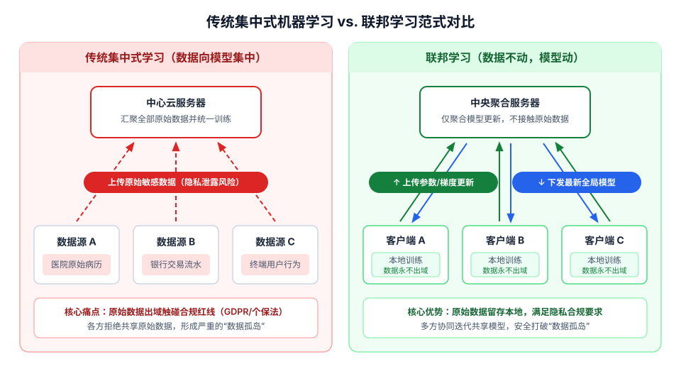
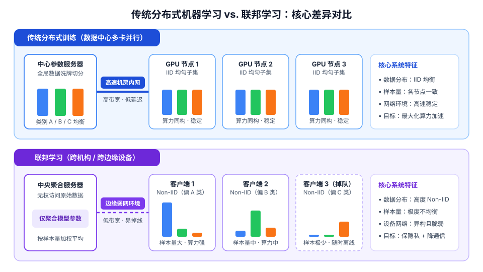

# 联邦学习第一课时：背景动机与范式重构

> **学习目标**
> 1. 理解传统集中式机器学习在现实落地中面临的两大死结：**数据孤岛**与**隐私合规**。
> 2. 建立联邦学习“**数据不动，模型动**”的底层范式直觉，区分 **Cross-Silo（跨机构）** 与 **Cross-Device（跨设备）** 两类典型场景。
> 3. 从数据分布、算力异构与通信瓶颈三个维度，彻底厘清**联邦学习**与**传统分布式机器学习**的本质差异。

---

## 1. 为什么传统机器学习走不通了？

传统集中式机器学习（Centralized Machine Learning）的基本前提是**“数据向模型集中”**：将分散在各医院、银行或手机终端的原始数据全部上传至云端中心服务器，汇总成一个庞大的数据集后再统一训练模型。

在真实工业与科研场景中，这种范式撞上了两堵硬墙：

1. **隐私与合规红线**
   医疗影像、病历档案、金融征信流水、个人输入记录等属于高度敏感数据。随着欧盟 **GDPR**、中国《数据安全法》与《个人信息保护法》等法规的落地，原始数据严禁未经授权出域流通或跨机构交易。
2. **数据孤岛（Data Silos）**
   现实中的高质量数据天然分散在不同机构或海量终端手中。由于商业竞争、数据主权与合规限制，各方无法直接合并数据；而单靠某一家机构的数据，样本量与覆盖面往往不足，导致训练出的模型泛化能力差、容易过拟合。

> [!IMPORTANT]
> **核心矛盾**：AI 模型需要海量、多样化的数据来提升泛化能力，但隐私法规与商业壁垒要求原始数据必须留在本地。联邦学习正是为了在“**数据不出域**”的前提下打破“**数据孤岛**”而诞生的。

---

## 2. 联邦学习的核心范式：数据不动，模型动

**联邦学习（Federated Learning, FL）**是一种面向隐私保护的分布式机器学习范式。其核心思想可以概括为一句话：**数据不动，模型动（Data Stays, Model Moves）**。

* **原始数据严格留在本地**：客户端（医院、银行、手机等）无需向服务器或任何第三方上传原始样本。
* **仅交换模型参数或梯度**：各客户端基于本地数据计算模型更新（参数 $w$ 或梯度更新量 $\Delta w$），经加密或脱敏处理后上传至中央协调服务器。
* **多方协作迭代全局模型**：服务器聚合各方上传的更新，生成新一代全局模型并下发给各客户端，循环迭代直至模型收敛。

### 延伸视角：联邦学习的两大落地形态

在阅读文献和工程落地时，联邦学习通常按参与方形态划分为两类：

| 对比维度 | 跨机构联邦（Cross-Silo FL） | 跨设备联邦（Cross-Device FL） |
| :--- | :--- | :--- |
| **参与方** | 机构或组织（如多家医院、银行、科研院所） | 海量边缘终端（如智能手机、IoT 传感器、车载终端） |
| **节点规模** | 较少（通常 $2 \sim 100$ 个机构） | 极大（可达数万至数亿台设备） |
| **算力与在线率** | 服务器级算力，几乎全天候稳定在线 | 算力与电量受限，随时可能断网或退出训练 |
| **核心关注点** | 数据安全合规、激励机制、纵向特征对齐 | 极致的通信压缩、容错率、掉队者（Straggler）处理 |
| **典型案例** | 多院区联合肺结节检测、银行与电商联合风控 | Google Gboard 手机输入法下一词预测 |

---

## 3. 易错辨析：联邦学习 vs. 传统分布式机器学习

初学联邦学习时，最容易产生的误区是将其等同于“多台机器一起跑训练”（即数据中心内部的传统分布式训练，如多卡 GPU 数据并行）。**二者在底层假设与核心瓶颈上存在本质区别：**

| 对比维度 | 传统分布式训练（数据中心多卡并行） | 联邦学习（Federated Learning） |
| :--- | :--- | :--- |
| **数据分布** | 中心节点主动打乱并切分，满足**独立同分布（IID）** | 各客户端自然产生，高度**非独立同分布（Non-IID）** |
| **样本量均衡性** | 各计算节点分得的数据量基本一致 | 极度不均衡（如三甲医院样本极多，社区诊所极少） |
| **节点控制权** | 中心调度器对所有 GPU 节点拥有完全控制权 | 客户端拥有数据与设备的绝对自主权，随时可能离线 |
| **通信环境** | 数据中心高速互联（NVLink / InfiniBand），高带宽、低延迟 | 边缘公网或无线网络（Wi-Fi / 4G），上行带宽极窄且不稳定 |
| **硬件异构性** | 同构集群（相同型号的 GPU / 服务器） | 高度异构（芯片算力、内存、网络状况千差万别） |
| **核心瓶颈** | **计算受限（Compute-bound）**：核心目标是加速大规模计算 | **通信与异构受限（Communication-bound）**：核心目标是保护隐私、减少通信轮数、克服数据分布偏移 |

> [!NOTE]
> **第一性原理思考**：为什么不能直接把数据中心的并行 SGD 算法搬到联邦学习中？
> 在数据中心里，每算 1 个 Batch 就同步一次梯度是可行的，因为光纤带宽极高且各卡算力一致；但在联邦学习中，弱网环境下频繁同步梯度会直接拖垮通信，且 Non-IID 数据会导致不同客户端的梯度方向严重冲突。这直接催生了后续课时要讲的核心算法——**FedAvg**。

---

## 4. 课后自测与思考题

尝试脱离笔记回答以下问题，检验是否真正掌握第一课时核心内容：

**Q1. 某互联网公司把自己的 1000 万条用户日志存放在云端集群中，切分成 16 份放到 16 张 GPU 上并行训练推荐模型。这属于联邦学习吗？为什么？**

点击展开参考解析

**不属于**，这属于**传统分布式机器学习（数据并行）**。
原因：
1. 原始数据已经汇总到同一个云端数据池中，不存在跨主体的数据孤岛与隐私隔离需求；
2. 数据是由中心节点主动打乱并均匀切分给各 GPU 的，满足 IID 且各节点同构、高速互联，优化目标是计算加速而非隐私保护与降通信。

**Q2. 既然联邦学习不上传原始数据，只上传模型参数或梯度，那是不是意味着它“绝对安全、不会泄露隐私”？**

点击展开参考解析

**不是。** “数据不出域”只是隐私保护的第一道防线。研究表明，梯度中蕴含着大量关于训练样本的特征信息，恶意服务器或中间人可以通过**梯度反演攻击（如 DLG）**从上传的梯度中重构出清晰的原始图像或文本。因此，实际联邦学习系统通常还需要结合**差分隐私（DP）**、**同态加密（HE）**或**安全多方计算（SMPC）**来加固隐私边界（将在第四课时详细展开）。

**Q3. 对比“5 家三甲医院联合训练肿瘤识别模型”与“100 万部智能手机联合训练输入法预测模型”，它们分别属于哪种联邦形态？工程设计侧重点有何不同？**

点击展开参考解析

* **5 家三甲医院**：属于 **Cross-Silo（跨机构联邦）**。节点少、算力强且稳定在线，每轮通常所有机构都会参与，工程重点在于严格的加密协议（防机构间窥探隐私）与利益分配机制。
* **100 万部智能手机**：属于 **Cross-Device（跨设备联邦）**。设备极多且随时可能断网/耗电，不可能每轮全员参与，工程重点在于客户端随机采样（仅抽一小部分空闲且充电的手机）、极致通信压缩以及应对掉队设备的容错机制。

---

## 5. 延伸阅读（经典必读）

1. **开山之作**：McMahan, B., et al. (2017). *Communication-Efficient Learning of Deep Networks from Decentralized Data*. AISTATS 2017.
2. **概念与分类经典综述**：Yang, Q., Liu, Y., Chen, T., & Tong, Y. (2019). *Federated Machine Learning: Concept and Applications*. ACM TIST, 10(2), 1-19.
3. **权威全景综述**：Kairouz, P., et al. (2021). *Advances and Open Problems in Federated Learning*. Foundations and Trends in Machine Learning.
