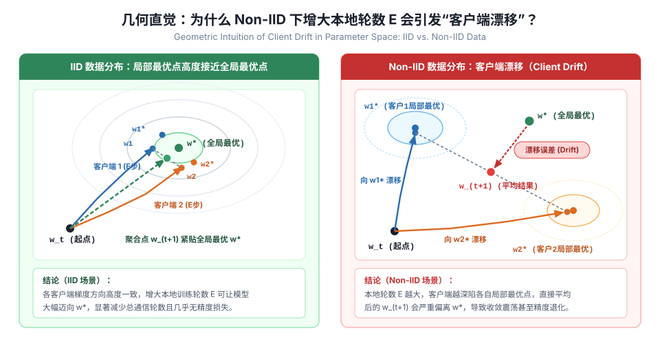

# 联邦学习第三课时：核心算法原理与 FedAvg 推导

> **学习目标**
> 1. 从第一性原理推导出联邦学习的**全局优化目标函数**，理解为什么聚合时必须按样本量 $`\frac{n_k}{n}`$ 加权。
> 2. 吃透从 **FedSGD** 到 **FedAvg** 的数学等价变形与演进逻辑（用本地算力换取通信带宽）。
> 3. 完整掌握 **FedAvg**（McMahan et al., 2017）的单轮四步通信闭环与标准伪代码。
> 4. 深入理解三大核心超参数（ $`C, E, B`$ ）的工程权衡，以及 Non-IID 数据下**客户端漂移**（Client Drift）的几何机理。

---

## 1. 全局优化目标函数：为什么必须按样本量加权？

假设联邦学习系统中共有 $`K`$ 个客户端，第 $`k`$ 个客户端在本地持有私有数据集 $`\mathcal{P}_k`$ ，其样本数量为 $`n_k = \vert{}\mathcal{P}_k\vert{}`$ ，全网总样本数为 $`n = \sum_{k=1}^{K} n_k`$ 。

联邦学习的核心目标，是在不汇总原始数据的前提下，求解一组全局模型参数 $`w \in \mathbb{R}^d`$ ，最小化**全局经验风险**：

$$\min_{w \in \mathbb{R}^d} f(w) = \sum_{k=1}^{K} \frac{n_k}{n} F_k(w)$$

其中，第 $`k`$ 个客户端的本地目标函数 $`F_k(w)`$ 定义为本地所有样本损失的平均值：

$$F_k(w) = \frac{1}{n_k} \sum_{i \in \mathcal{P}_k} f_i(w)$$

这里 $`f_i(w) = \ell(x_i, y_i; w)`$ 表示模型参数 $`w`$ 在第 $`i`$ 个样本上的预测损失。

> [!IMPORTANT]
> **第一性原理验证：为什么要乘以权重 $`\frac{n_k}{n}`$ ，而不是直接对 $`K`$ 个客户端取均匀平均 $`\frac{1}{K}`$ ？**
>
> 将 $`F_k(w)`$ 代入全局目标函数展开：
>
> $$ > f(w) = \sum_{k=1}^{K} \frac{n_k}{n} \left( \frac{1}{n_k} \sum_{i \in \mathcal{P}_k} f_i(w) \right) = \frac{1}{n} \sum_{k=1}^{K} \sum_{i \in \mathcal{P}_k} f_i(w) = \frac{1}{n} \sum_{i=1}^{n} f_i(w) > $$
>
> 可见，**只有按样本量比例 $`\frac{n_k}{n}`$ 加权，全局目标函数在数学上才严格等价于“把所有客户端的数据集中到云端算平均损失”**。
> 如果误用均匀平均 $`\frac{1}{K}`$ ，当客户端样本量极度不均衡时（例如大医院有 10,000 例、小诊所只有 10 例），小诊所每条样本的话语权会被放大 1000 倍，导致全局模型严重过拟合小节点并偏离真实分布。

---

## 2. 从 FedSGD 到 FedAvg：用本地算力换通信带宽

### 2.1 基准方案：FedSGD（联邦随机梯度下降）

求解上述优化问题最直接的想法，是把数据中心的同步梯度下降搬过来——即 **FedSGD**：
1. 在第 $`t`$ 轮，服务器将当前全局参数 $`w_t`$ 下发给所有客户端。
2. 每个客户端 $`k`$ 在本地全量数据上计算一次精确梯度 $`g_k = \nabla F_k(w_t)`$ 并上传。
3. 服务器对梯度按样本量加权平均，执行一步梯度下降：

$$w_{t+1} \leftarrow w_t - \eta \sum_{k=1}^{K} \frac{n_k}{n} g_k$$

* **致命痛点**：深度神经网络收敛往往需要上万次参数更新。FedSGD **每更新 1 步参数就必须全网通信 1 次**，在手机、IoT 等弱网边缘设备上，高昂的上行通信延迟会直接拖垮训练。

### 2.2 核心突破：FedAvg（联邦平均）的数学等价与推广

McMahan 等人在 2017 年开山论文中敏锐地注意到，FedSGD 的全局更新公式可以通过线性重组写成完全等价的**参数平均形式**：

$$w_{t+1} = w_t - \eta \sum_{k=1}^{K} \frac{n_k}{n} g_k = \sum_{k=1}^{K} \frac{n_k}{n} \underbrace{\left( w_t - \eta g_k \right)}_{w_{t+1}^k}$$

这一步代数变形揭示了一个极具工程价值的事实：
* 服务器“聚合梯度后再更新”，在单步情况下完全等价于“各客户端在本地先更新出新参数 $`w_{t+1}^k`$ ，服务器再直接对参数做加权平均”。

**FedAvg 的核心思想由此诞生**：既然客户端本地有空闲算力，不如把原本的“本地算 1 步全量梯度就上传”，改为**“客户端在本地用小批量数据（Mini-batch）连续多跑几步 SGD（共跑 $`E`$ 个 Epoch），等本地参数充分更新后再一次性上传聚合”**。

通过**增加本地计算量**，FedAvg 可将达到同等精度所需的总通信轮数压缩 **10 倍至 100 倍**。

---

## 3. FedAvg 单轮通信闭环与完整伪代码


### 3.1 单轮通信的标准四步流程（第 $`t`$ 轮）

1. **客户端采样与下发**：服务器按参与率 $`C \in (0, 1]`$ 随机抽取 $`m = \max(\lfloor C \cdot K \rfloor, 1)`$ 个在线客户端组成集合 $`S_t`$ ，将当前全局模型参数 $`w_t`$ 广播给它们。
2. **本地多步更新**：每个被选中的客户端 $`k \in S_t`$ 以 $`w_t`$ 为起点，将本地数据 $`\mathcal{P}_k`$ 按批量大小 $`B`$ 切分为若干 Mini-batch，在本地执行 $`E`$ 个 Epoch 的小批量梯度下降：

$$w \leftarrow w - \eta \nabla \ell(w; b)$$

3. **参数上传**：客户端将本地训练完成后的模型参数 $`w_{t+1}^k`$ 上传至服务器（原始数据全程不出本地）。
4. **样本量加权聚合**：服务器收集所有选中客户端的参数，按**本轮参与客户端的总样本量** $`n_{S_t} = \sum_{k \in S_t} n_k`$ 归一化后加权平均，得到新一轮全局模型：

$$w_{t+1} \leftarrow \sum_{k \in S_t} \frac{n_k}{n_{S_t}} w_{t+1}^k$$

### 3.2 FedAvg 标准算法伪代码（McMahan et al., 2017）

```text
算法：FederatedAveraging (FedAvg)
输入：总客户端数 K，参与率 C，本地批量大小 B，本地训练轮数 E，学习率 η，总通信轮数 T

【服务器端执行 (Server executes)】
1. 随机初始化全局模型参数 w_0
2. for 通信轮次 t = 0, 1, ..., T-1 do:
3.     m ← max(C · K, 1)
4.     S_t ← 从 K 个客户端中随机抽取 m 个客户端组成集合
5.     for 每个客户端 k ∈ S_t (并行执行) do:
6.         w_(t+1)^k ← ClientUpdate(k, w_t)
7.     n_(S_t) ← Σ_(k ∈ S_t) n_k
8.     w_(t+1) ← Σ_(k ∈ S_t) (n_k / n_(S_t)) · w_(t+1)^k   // 加权平均聚合

【客户端本地执行 ClientUpdate(k, w)】
1. B_k ← 将本地数据集 P_k 切分为大小为 B 的若干批次 (batches)
2. for 本地轮次 e = 1, 2, ..., E do:
3.     for 每个批次 b ∈ B_k do:
4.         w ← w - η · ∇l(w; b)                          // 本地小批量梯度下降
5. return w 至中央服务器
```

> [!NOTE]
> **工程细节提示**：为什么实际实现中分母常用 $`n_{S_t} = \sum_{k \in S_t} n_k`$ 而不是全网总样本数 $`n`$ ？
> 因为在跨设备联邦中每轮只抽样了部分客户端（ $`S_t \subset \{1, \dots, K\}`$ ），若直接除以全网总样本数 $`n`$ ，权重之和 $`\sum_{k \in S_t} \frac{n_k}{n} \ll 1`$ ，会导致模型参数被严重缩小。用 $`n_{S_t}`$ 归一化才能保证聚合权重之和恒为 1（凸组合）。

---

## 4. 三大超参数的工程权衡与“客户端漂移”

FedAvg 的性能与通信效率主要由三个超参数控制： $`C`$ 、 $`E`$ 、 $`B`$ 。

| 超参数 | 物理含义 | 增大该参数的收益 | 增大该参数的代价 / 风险 |
| :--- | :--- | :--- | :--- |
| **参与率** $`C`$ | 每轮被选中参与训练的客户端比例 | 每轮梯度估计方差更小，收敛曲线更平稳 | 单轮通信带宽压力剧增，且更容易遭遇慢设备拖累（掉队者效应） |
| **本地轮数** $`E`$ | 客户端每轮通信前遍历本地数据的次数 | 本地挖掘更充分，**大幅减少总通信轮数** | 在 **Non-IID** 数据下会诱发严重的**客户端漂移**，导致聚合后精度下降 |
| **本地批大小** $`B`$ | 客户端本地 SGD 的单步样本批次大小 | 单步梯度噪声更小，硬件矩阵并行利用率高 | 同样 1 个 Epoch 内的参数更新步数减少（步数 $`= E \cdot \lceil n_k / B \rceil`$ ），通信压缩收益变小 |

> [!TIP]
> **特例回归**：当设置 $`C = 1`$ （全员参与）、 $`E = 1`$ （本地只跑 1 轮）且 $`B = \infty`$ （每个客户端把全部本地数据作为一个 Batch）时，FedAvg 在数学上**严格退化为 FedSGD**。

### 4.1 深度剖析：为什么 Non-IID 下盲目增大 $`E`$ 会适得其反？

这是联邦学习理论中最核心的现象——**客户端漂移**（Client Drift）。在参数空间中对比 **IID** 与 **Non-IID** 两种情况，可以直观看出其几何本质：



* **在 IID 数据下**：各客户端的数据分布几乎一致，各自的局部最优解 $`w_1^*, w_2^*`$ 都紧紧围绕在真正的全局最优解 $`w^*`$ 附近。此时从 $`w_t`$ 出发多跑几步（增大 $`E`$ ），大家都在朝着同一个大方向前进，加权平均后的 $`w_{t+1}`$ 会一步逼近 $`w^*`$ 。
* **在 Non-IID 数据下**：各客户端的数据分布差异极大（例如医院 A 多为老年病例、医院 B 多为儿童病例），导致每个客户端的局部最优解 $`w_k^*`$ 彼此相距甚远，且都偏离全局最优解 $`w^*`$ 。
  * 如果 $`E`$ 很小（例如 $`E = 1`$ ），各客户端只沿着初始点 $`w_t`$ 的切线方向迈出一小步，平均后的方向依然接近全局真实负梯度方向。
  * 一旦 $`E`$ 很大，各客户端就会在本地过度拟合自己的局部数据，一路“漂移”到各自孤立的局部最优点 $`w_k^*`$ 。此时服务器对差异巨大的参数做简单线性平均，落点 $`w_{t+1}`$ 反而可能掉入高损失区域，引起收敛震荡甚至精度退化。

这也直接引出了第四课时的核心主题：**如何在 Non-IID 与弱网现实下驯服客户端漂移？**（如 FedProx、SCAFFOLD 等改进算法）。

---

## 5. 课后自测与思考题

**Q1. 假设有 2 个客户端参与 FedAvg 训练，客户端 1 有 1000 条样本，客户端 2 有 100 条样本。如果设定相同的本地批量大小 $`B = 50`$ 和本地轮数 $`E = 2`$ ，它们在一轮通信中分别执行了多少次本地梯度更新？这种更新次数的差异会带来什么潜在问题？**

<details>
<summary>点击展开参考解析</summary>

* **更新次数计算**：
  * 客户端 1：每个 Epoch 有 $`1000 / 50 = 20`$ 个 Batch，跑 $`E = 2`$ 轮共执行 **40 次**梯度更新。
  * 客户端 2：每个 Epoch 有 $`100 / 50 = 2`$ 个 Batch，跑 $`E = 2`$ 轮共执行 **4 次**梯度更新。
* **潜在问题（目标不一致 / Objective Inconsistency）**：
  客户端 1 走了 40 步而客户端 2 只走了 4 步，导致大客户端的模型参数偏离初始点 $`w_t`$ 的幅度远大于小客户端。在样本量严重不均衡且数据 Non-IID 时，这种步数不对等会进一步加剧全局模型向大客户端偏斜（这是后续 **FedNova** 等算法专门解决的痛点）。

</details>

**Q2. 为什么在深度神经网络（非凸优化）上，直接对两个训练好的模型参数做加权平均 $`w = \frac{1}{2} w^{(1)} + \frac{1}{2} w^{(2)}`$ 往往会彻底毁掉模型，但在 FedAvg 中这样做却能有效收敛？**

<details>
<summary>点击展开参考解析</summary>

核心原因在于**同一起点初始化**（Shared Initialization）。
* 神经网络存在**排列对称性**（Permutation Invariance）：两个从不同随机初始化独立训练出来的神经网络，即使结构相同、任务相同，其隐藏层神经元的语义对应关系也是打乱的，直接按位置平均权重会导致特征彻底混乱。
* 而在 FedAvg 的每一轮通信开始前，所有客户端都**强制从同一个全局模型 $`w_t`$ 出发**，并且在本地只更新有限步数（ $`E`$ 不宜过大）。因为共享起点且偏离距离受控，各客户端的参数仍处于同一个局部损失盆地（Loss Basin）内，神经元功能保持对齐，因此参数线性平均依然有效。

</details>

**Q3. 如果你正在部署一个面向 10 万台手机的跨设备（Cross-Device）联邦学习系统，且发现网络带宽极度紧张，你应该优先调大还是调小 $`C`$ 和 $`E`$ ？需要注意什么边界条件？**

<details>
<summary>点击展开参考解析</summary>

* **参与率 $`C`$ **：应设为**较小值**（例如 $`C = 0.01`$ 或每轮固定抽样几百台处于充电+Wi-Fi 状态的手机），既大幅降低单轮并发通信开销，又减少等待掉队设备的概率。
* **本地轮数 $`E`$ **：应**适度调大**（如 $`E = 3 \sim 5`$ ），用手机本地算力换取更少的总通信轮数；但**不能盲目调得过大**，因为手机用户数据高度 Non-IID，过大的 $`E`$ 会触发严重客户端漂移，反而拖慢收敛速度或拉低最终精度。工程上通常需要通过验证集在“通信轮数”与“漂移误差”之间寻找拐点。

</details>

---

## 6. 延伸阅读

1. **FedAvg 开山论文**：McMahan, B., Moore, E., Ramage, D., Hampson, S., & y Arcas, B. A. (2017). *Communication-Efficient Learning of Deep Networks from Decentralized Data*. AISTATS 2017.
2. **Non-IID 收敛理论分析**：Li, X., Huang, K., Yang, W., Wang, S., & Zhang, Z. (2020). *On the Convergence of FedAvg on Non-IID Data*. ICLR 2020.
3. **步数不对等与目标不一致问题**：Wang, J., Liu, Q., Liang, H., Joshi, G., & Poor, H. V. (2020). *Tackling the Objective Inconsistency Problem in Heterogeneous Federated Optimization (FedNova)*. NeurIPS 2020.
