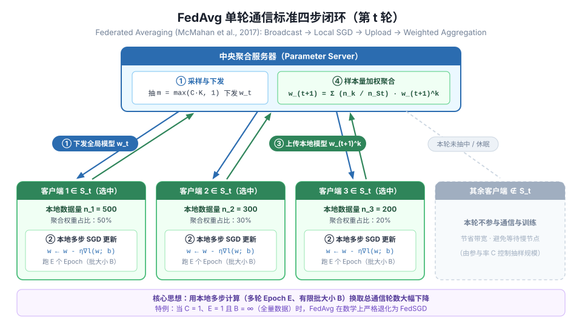

# 联邦学习第三课时：核心算法原理与 FedAvg 推导

> **学习目标**
> 1. 从第一性原理推导出联邦学习的**全局优化目标函数**，理解为什么聚合时必须按样本量 $\frac{n_k}{n}$ 加权。
> 2. 吃透从 **FedSGD** 到 **FedAvg** 的数学等价变形与演进逻辑（用本地算力换取通信带宽）。
> 3. 完整掌握 **FedAvg**（McMahan et al., 2017）的单轮四步通信闭环与标准伪代码。
> 4. 深入理解三大核心超参数（ $C, E, B$ ）的工程权衡，以及 Non-IID 数据下**客户端漂移**（Client Drift）的几何机理。

---

## 1. 全局优化目标函数：为什么必须按样本量加权？

假设联邦学习系统中共有 $K$ 个客户端，第 $k$ 个客户端在本地持有私有数据集 $\mathcal{P} _k$ ，其样本数量为 $n_k = \vert{}\mathcal{P} _k\vert{}$ ，全网总样本数为 $n = \sum_{k=1}^{K} n_k$ 。

联邦学习的核心目标，是在不汇总原始数据的前提下，求解一组全局模型参数 $w \in \mathbb{R}^d$ ，最小化**全局经验风险**：

$$\min_{w \in \mathbb{R}^d} f(w) = \sum_{k=1}^{K} \frac{n_k}{n} F_k(w)$$

其中，第 $k$ 个客户端的本地目标函数 $F_k(w)$ 定义为本地所有样本损失的平均值：

$$F_k(w) = \frac{1}{n_k} \sum_{i \in \mathcal{P} _k} f_i(w)$$

这里 $f_i(w) = \ell(x_i, y_i; w)$ 表示模型参数 $w$ 在第 $i$ 个样本上的预测损失。

> [!IMPORTANT]
> **第一性原理验证：为什么要乘以权重 $\frac{n_k}{n}$ ，而不是直接对 $K$ 个客户端取均匀平均 $\frac{1}{K}$ ？**
> 将 $F_k(w)$ 代入全局目标函数展开：
>
> $$ > f(w) = \sum_{k=1}^{K} \frac{n_k}{n} \left( \frac{1}{n_k} \sum_{i \in \mathcal{P} _k} f_i(w) \right) = \frac{1}{n} \sum_{k=1}^{K} \sum_{i \in \mathcal{P} _k} f_i(w) = \frac{1}{n} \sum_{i=1}^{n} f_i(w) > $$
>
> 可见，**只有按样本量比例 $\frac{n_k}{n}$ 加权，全局目标函数在数学上才严格等价于“把所有客户端的数据集中到云端算平均损失”**。
> 如果误用均匀平均 $\frac{1}{K}$ ，当客户端样本量极度不均衡时（例如大医院有 10,000 例、小诊所只有 10 例），小诊所每条样本的话语权会被放大 1000 倍，导致全局模型严重过拟合小节点并偏离真实分布。

---

## 2. 从 FedSGD 到 FedAvg：用本地算力换通信带宽

### 2.1 基准方案：FedSGD（联邦随机梯度下降）

求解上述优化问题最直接的想法，是把数据中心的同步梯度下降搬过来——即 **FedSGD**：
1. 在第 $t$ 轮，服务器将当前全局参数 $w_t$ 下发给所有客户端。
2. 每个客户端 $k$ 在本地全量数据上计算一次精确梯度 $g_k = \nabla F_k(w_t)$ 并上传。
3. 服务器对梯度按样本量加权平均，执行一步梯度下降：

$$w_{t+1} \leftarrow w_t - \eta \sum_{k=1}^{K} \frac{n_k}{n} g_k$$

* **致命痛点**：深度神经网络收敛往往需要上万次参数更新。FedSGD **每更新 1 步参数就必须全网通信 1 次**，在手机、IoT 等弱网边缘设备上，高昂的上行通信延迟会直接拖垮训练。

### 2.2 核心突破：FedAvg（联邦平均）的数学等价与推广

McMahan 等人在 2017 年开山论文中敏锐地注意到，FedSGD 的全局更新公式可以通过线性重组写成完全等价的**参数平均形式**：

$$w_{t+1} = w_t - \eta \sum_{k=1}^{K} \frac{n_k}{n} g_k = \sum_{k=1}^{K} \frac{n_k}{n} \underbrace{\left( w_t - \eta g_k \right)}_{w_{t+1}^k}$$

这一步代数变形揭示了一个极具工程价值的事实：
* 服务器“聚合梯度后再更新”，在单步情况下完全等价于“各客户端在本地先更新出新参数 $w_{t+1}^k$ ，服务器再直接对参数做加权平均”。

**FedAvg 的核心思想由此诞生**：既然客户端本地有空闲算力，不如把原本的“本地算 1 步全量梯度就上传”，改为**“客户端在本地用小批量数据（Mini-batch）连续多跑几步 SGD（共跑 $E$ 个 Epoch），等本地参数充分更新后再一次性上传聚合”**。

通过**增加本地计算量**，FedAvg 可将达到同等精度所需的总通信轮数压缩 **10 倍至 100 倍**。

---

## 3. FedAvg 单轮通信闭环与完整伪代码



### 3.1 单轮通信的标准四步流程（第 $t$ 轮）

1. **客户端采样与下发**：服务器按参与率 $C \in (0, 1]$ 随机抽取 $m = \max(\lfloor C \cdot K \rfloor, 1)$ 个在线客户端组成集合 $S_t$ ，将当前全局模型参数 $w_t$ 广播给它们。
2. **本地多步更新**：每个被选中的客户端 $k \in S_t$ 以 $w_t$ 为起点，将本地数据 $\mathcal{P} _k$ 按批量大小 $B$ 切分为若干 Mini-batch，在本地执行 $E$ 个 Epoch 的小批量梯度下降：

$$w \leftarrow w - \eta \nabla \ell(w; b)$$

3. **参数上传**：客户端将本地训练完成后的模型参数 $w_{t+1}^k$ 上传至服务器（原始数据全程不出本地）。
4. **样本量加权聚合**：服务器收集所有选中客户端的参数，按**本轮参与客户端的总样本量** $n_{S_t} = \sum_{k \in S_t} n_k$ 归一化后加权平均，得到新一轮全局模型：

$$w_{t+1} \leftarrow \sum_{k \in S_t} \frac{n_k}{n_{S_t}} w_{t+1}^k$$

### 3.2 FedAvg 标准算法伪代码（McMahan et al., 2017）

```text
算法：FederatedAveraging (FedAvg)
输入：总客户端数 K，参与率 C，本地批量大小 B，本地训练轮数 E，学习率 η，总通信轮数 T

【服务器端执行 (Server executes)】
1. 随机初始化全局模型参数 w_0
2. for 通信轮次 t = 0, 1, ..., T-1 do:
3.     m ← max(C · K, 1)
4.     S_t ← 从 K 个客户端中随机抽取 m 个客户端组成集合
5.     for 每个客户端 k ∈ S_t (并行执行) do:
6.         w_(t+1)^k ← ClientUpdate(k, w_t)
7.     n_(S_t) ← Σ_(k ∈ S_t) n_k
8.     w_(t+1) ← Σ_(k ∈ S_t) (n_k / n_(S_t)) · w_(t+1)^k   // 加权平均聚合

【客户端本地执行 ClientUpdate(k, w)】
1. B_k ← 将本地数据集 P_k 切分为大小为 B 的若干批次 (batches)
2. for 本地轮
