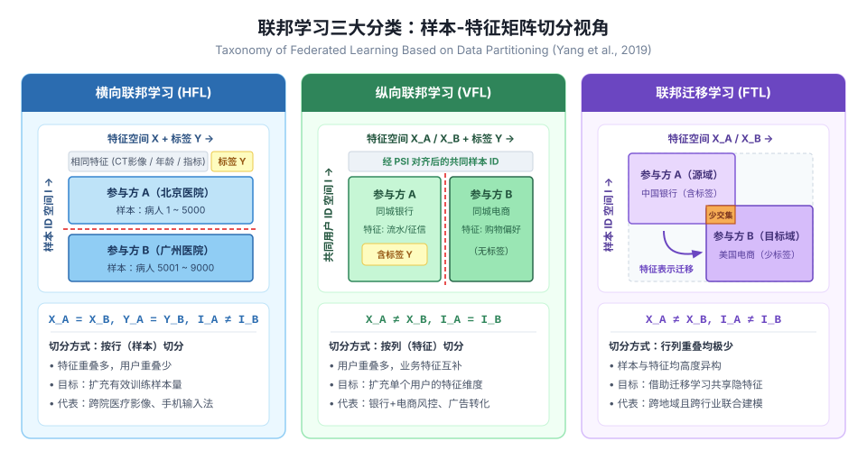
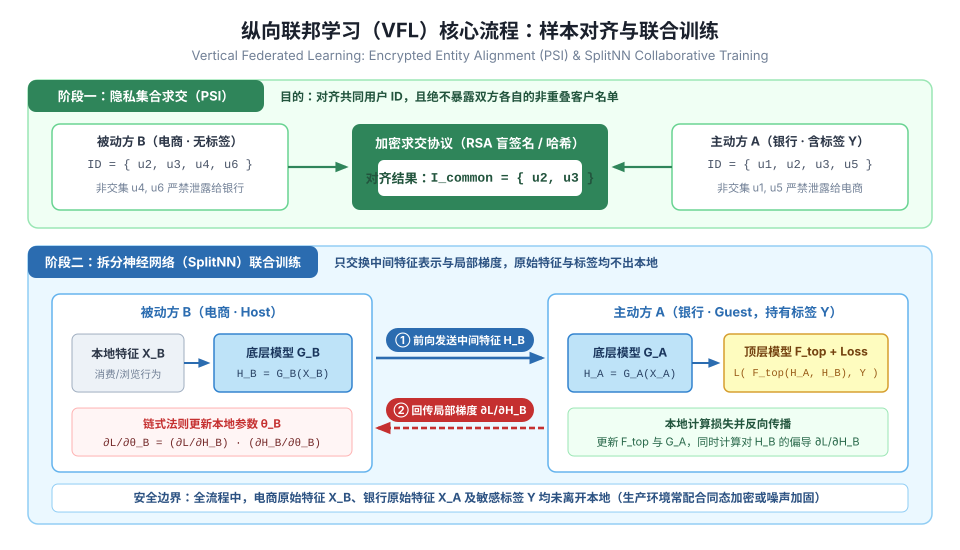

# 联邦学习第二课时：三大分类与数据矩阵视角

> **学习目标**
> 1. 掌握用样本-特征数学矩阵 $\mathcal{D}_i = (\mathcal{X}_i, \mathcal{Y}_i, \mathcal{I}_i)$ 严格刻画不同业务场景的数据分布形态。
> 2. 彻底分清**横向联邦学习**（HFL）、**纵向联邦学习**（VFL）与**联邦迁移学习**（FTL）的切分方式、数学条件与落地场景。
> 3. 从第一性原理吃透纵向联邦学习的两大核心机制：**隐私集合求交**（PSI）与**拆分神经网络**（SplitNN）联合训练。

---

## 1. 数学建模视角：样本、特征与标签矩阵

在工程和科研中，判断一个业务究竟适合哪种联邦学习，不能靠直觉猜，最严谨的方式是把每个参与方 $i$ 的本地数据集写成一张二维数据表（矩阵）：

$$\mathcal{D}_i = (\mathcal{X}_i, \mathcal{Y}_i, \mathcal{I}_i)$$

其中三个集合分别对应数据表的不同维度：
* **$\mathcal{I}_i$（样本 ID 空间）**：表格的**行**，代表具体的个体对象（例如某位病人、某个银行客户、某台手机）。
* **$\mathcal{X}_i$（特征空间）**：表格的**列**，代表用于预测的输入属性（例如 CT 影像像素、年龄、月收入、电商购物偏好）。
* **$\mathcal{Y}_i$（标签空间）**：表格的**目标列**，代表监督学习要预测的结果（例如是否确诊肺癌、贷款是否违约、点击广告与否）。

基于各参与方在 **$\mathcal{X}$**、**$\mathcal{Y}$**、**$\mathcal{I}$** 三个空间上的重叠程度，杨强等人在 2019 年的经典论文中将联邦学习划分为三大范式。

---

## 2. 联邦学习三大范式详解（矩阵切分视角）

### 2.1 横向联邦学习（Horizontal Federated Learning, HFL）

* **数学条件**：
  $$\mathcal{X}_i = \mathcal{X}_j, \quad \mathcal{Y}_i = \mathcal{Y}_j, \quad \mathcal{I}_i \neq \mathcal{I}_j, \quad \forall \mathcal{D}_i, \mathcal{D}_j, \ i \neq j$$
* **直觉理解**：**按行切分**（特征重叠多、用户重叠少）。各参与方干的是**同一种业务**，采集的特征字段和预测目标完全一致，但服务的用户群体基本不重合。
* **核心价值**：**扩充有效样本量**，解决单机构数据量不足、模型泛化能力弱的问题。
* **典型场景**：
  * **智慧医疗**：北京医院与广州医院联合训练肺结节检测模型（特征都是肺部 CT 与基础病史，但病人几乎不重叠）。
  * **移动终端**：数百万台智能手机通过 Google Gboard 联合优化下一词预测模型（每个用户的输入习惯互不重叠，但词表与任务完全一致）。

### 2.2 纵向联邦学习（Vertical Federated Learning, VFL）

* **数学条件**：
  $$\mathcal{X}_i \neq \mathcal{X}_j, \quad \mathcal{Y}_i \neq \mathcal{Y}_j \text{（通常仅一方有标签）}, \quad \mathcal{I}_i = \mathcal{I}_j, \quad \forall \mathcal{D}_i, \mathcal{D}_j, \ i \neq j$$
* **直觉理解**：**按列切分**（用户重叠多、特征重叠少）。各参与方处于**同一地域但不同行业**，面对高度重合的同一批用户，各自掌握不同的侧面画像。
* **核心价值**：**扩充单个样本的特征维度**，把多维互补信息融合起来，显著提升预测精度。
* **典型场景**：
  * **金融风控**：同城银行（掌握资产流水、征信与“是否违约”标签 $Y$）与同城电商（掌握消费习惯、收货稳定性）联合做信用评分。
  * **精准广告**：媒体平台（有用户浏览兴趣特征）与品牌电商（有实际下单转化标签 $Y$）联合预测广告转化率（CTR / CVR）。

### 2.3 联邦迁移学习（Federated Transfer Learning, FTL）

* **数学条件**：
  $$\mathcal{X}_i \neq \mathcal{X}_j, \quad \mathcal{Y}_i \neq \mathcal{Y}_j, \quad \mathcal{I}_i \neq \mathcal{I}_j, \quad \forall \mathcal{D}_i, \mathcal{D}_j, \ i \neq j$$
* **直觉理解**：**行列重叠都极少**。参与方既跨行业、又跨地域，共同用户和相同特征都非常稀缺。
* **核心机制**：不能直接拼行或拼列，需要引入**迁移学习**（Transfer Learning），在保护隐私的前提下，利用少量共同样本学习一个**共享的潜在特征表示空间**（Common Representation），将源域（数据/标签丰富）的知识迁移到目标域（标签稀缺）。
* **典型场景**：中国的银行与美国的电商合作建模；或不同医疗模态、不同人群分布之间的跨界辅助诊断。

### 2.4 三大范式全景对比

| 对比维度 | 横向联邦学习（HFL） | 纵向联邦学习（VFL） | 联邦迁移学习（FTL） |
| :--- | :--- | :--- | :--- |
| **矩阵切分方式** | 按行（样本）切分 | 按列（特征）切分 | 样本与特征重叠均极少 |
| **样本重叠度** | 低（$\mathcal{I}_i \neq \mathcal{I}_j$） | 高（$\mathcal{I}_i = \mathcal{I}_j$） | 极低（$\mathcal{I}_i \neq \mathcal{I}_j$） |
| **特征重叠度** | 高（$\mathcal{X}_i = \mathcal{X}_j$） | 低（$\mathcal{X}_i \neq \mathcal{X}_j$） | 极低（$\mathcal{X}_i \neq \mathcal{X}_j$） |
| **标签归属** | 所有参与方均持有完整标签 | 通常仅**主动方**（Guest）持有标签 | 通常仅源域持有大量标签 |
| **扩充维度** | 扩充样本量（行变多） | 扩充特征维度（列变多） | 跨域知识迁移 |
| **核心交换内容** | 完整模型参数 $w$ 或梯度 $\Delta w$ | 中间特征表示 $H$ 与局部梯度 $\frac{\partial \mathcal{L}}{\partial H}$ | 加密后的共享隐层表示与迁移损失 |
| **典型架构/算法** | FedAvg、FedProx、SCAFFOLD | PSI + SplitNN、SecureBoost | 联邦深度迁移学习 |

> [!TIP]
> **学术界 vs. 工业界的关注重心差异**
> * **学术界**：80% 以上的论文默认研究**横向联邦学习**（HFL），核心聚焦在 Non-IID 收敛理论、通信压缩与安全鲁棒聚合（第三、四课时的重点）。
> * **工业界**：在金融、政务、广告等高价值 ToB 场景中，**纵向联邦学习**（VFL）的落地需求极大，因为同一城市的银行和互联网平台天然覆盖同一批人，特征互补带来的商业增益立竿见影。

---

## 3. 深入纵向联邦（VFL）：样本对齐与联合训练机制

横向联邦的直觉很好理解（大家各练各的模型，最后把参数平均一下）；但纵向联邦面临两个棘手问题：
1. **怎么找共同用户而不泄露独有客户名单？**（银行绝不能把全部客户手机号直接发给电商做 `INNER JOIN`）
2. **标签 $Y$ 只在银行手里，电商连损失函数 $\mathcal{L}$ 都算不出来，怎么更新自己的模型？**

为了解决这两个问题，纵向联邦标准流程分为两个阶段：

### 3.1 阶段一：隐私集合求交（PSI, Private Set Intersection）

在正式训练前，双方必须对齐同一个用户在不同系统中的样本行顺序，且满足**“交集外零泄露”**。以经典的 **RSA 盲签名 PSI** 直觉为例：

1. **盲化加密**：假设银行（主动方 A）持有公钥 $(e, n)$ 和私钥 $d$。电商（被动方 B）先把自己的用户 ID $u_b$ 做哈希，再乘上一个随机盲因子 $r^e$ 混淆后发给银行。因为有随机数 $r$ 掩盖，银行根本看不出电商发来的是谁。
2. **盲签名与去盲**：银行用私钥 $d$ 对收到的盲化数据签名后发回给电商；电商除以随机数 $r$，就神奇地消掉了盲因子，得到“经过银行私钥签名的电商 ID 哈希值” $H(u_b)^d \bmod n$。
3. **密文求交**：银行也用同样的私钥对自己的用户 ID 计算 $H(u_a)^d \bmod n$ 并做二次哈希后发给电商。电商对比两份密文列表，**只有完全一致的才是共同用户**；对于不匹配的密文，由于哈希不可逆，双方都无法反推出对方的独有客户名单。

### 3.2 阶段二：拆分神经网络（SplitNN）联合训练

对齐共同样本后，以深度学习场景最经典的 **SplitNN** 架构为例，看链式法则如何打通“单方持标签”的死结：

* **角色划分**：
  * **被动方 B（Host，如电商）**：只有特征 $X_B$，本地部署底层特征提取网络 $G_B$（参数 $\theta_B$）。
  * **主动方 A（Guest，如银行）**：既有特征 $X_A$ 又有标签 $Y$，本地部署底层网络 $G_A$（参数 $\theta_A$）和顶层融合预测网络 $F_{\text{top}}$（参数 $\theta_{\text{top}}$）。

* **单步前向与反向传播闭环**：
  1. **各自前向提取**：对于同一批对齐用户，电商在本地算出中间特征向量 $H_B = G_B(X_B)$ 并发送给银行；银行在本地算出 $H_A = G_A(X_A)$。
  2. **主动方融合算 Loss**：银行把 $H_A$ 和收到的 $H_B$ 拼接送入顶层网络得到预测值 $\hat{y} = F_{\text{top}}(H_A, H_B)$，再结合本地标签 $Y$ 计算损失 $\mathcal{L}(\hat{y}, Y)$。
  3. **反向传播与局部梯度回传**：银行在本地更新 $F_{\text{top}}$ 和 $G_A$，同时计算损失对电商中间输出的偏导数 $\frac{\partial \mathcal{L}}{\partial H_B}$，仅将这一小段**中间层梯度**回传给电商。
  4. **被动方链式法则更新**：电商收到 $\frac{\partial \mathcal{L}}{\partial H_B}$ 后，不需要知道标签 $Y$ 是什么，直接利用微积分**链式法则**即可更新自己的底层参数 $\theta_B$：
     $$\frac{\partial \mathcal{L}}{\partial \theta_B} = \frac{\partial \mathcal{L}}{\partial H_B} \cdot \frac{\partial H_B}{\partial \theta_B}$$

> [!NOTE]
> **为什么纵向联邦比横向联邦通信更敏感？**
> 横向联邦（FedAvg）可以在本地连续训练多个 Epoch 再通信一次；而纵向联邦每训练 **1 个 Mini-batch** 都必须交互一次 $H_B$ 和 $\frac{\partial \mathcal{L}}{\partial H_B}$，通信频次高得多。此外，为了防止主动方从 $H_B$ 反推原始特征、或被动方从 $\frac{\partial \mathcal{L}}{\partial H_B}$ 推断出敏感标签（标签推断攻击），工业落地时通常还会结合**同态加密**（HE）或**梯度加噪**进行保护。

---

## 4. 实战判断：30 秒完成业务场景选型

拿到一个实际合作需求时，按以下 3 个问题依次排查，即可准确落位：

1. **参与方是否属于同一行业、采集相同类型的业务特征？**
   * 是（且各自服务不同地区/不同批次的用户） $\rightarrow$ **横向联邦学习（HFL）**。
2. **参与方是否跨行业，但面向同一批重叠度很高的用户？**
   * 是（特征互补、通常仅一方有业务结果标签） $\rightarrow$ **纵向联邦学习（VFL）**。
3. **参与方既不是同一批用户，特征字段也完全对不上？**
   * 是（仅能找到极少共同样本或共享领域规律） $\rightarrow$ **联邦迁移学习（FTL）**。

---

## 5. 课后自测与思考题

**Q1. 某国有大行在广东的分行与在黑龙江的分行，希望在不直接汇总储户明细的前提下联合训练反欺诈模型，应当选用哪种联邦学习？如果改为广东分行与广东本地一家打车平台合作评估车主信用，又该选哪种？**

点击展开参考解析

1. **广东分行 + 黑龙江分行**：属于**横向联邦学习**（HFL）。两家分行同属一家银行体系，业务特征字段（账户流水、交易频率、欺诈标签）完全一致，但覆盖的地域储户基本不重叠，属于“按行切分”。
2. **广东分行 + 广东本地打车平台**：属于**纵向联邦学习**（VFL）。双方同在广东，用户群体（本地车主/乘客）高度重叠，但银行有金融流水与违约标签、打车平台有接单时长与出行轨迹特征，属于“按列切分”，训练前需先执行 PSI 对齐共同用户 ID。

**Q2. 在纵向联邦的 PSI 阶段，为什么不能让银行和电商各自直接把用户手机号做一次标准的 SHA-256 哈希，然后直接发给对方比对交集？**

点击展开参考解析

**绝对不安全，极易遭受彩虹表/暴力枚举攻击。**
中国大陆手机号（11 位，且前 3 位号段固定）或身份证号的总搜索空间非常有限（约 $10^8 \sim 10^9$ 级别）。如果直接用公开无密钥的 SHA-256 哈希，攻击者用一台普通显卡几秒钟就能把所有手机号的哈希值全算出来建一张对照表，瞬间反查出对方全部非交集客户的真实手机号。因此必须引入带密钥的加密协议（如 RSA 盲签名或 ECDH-PSI），确保对方无法离线枚举。

**Q3. 在纵向联邦学习中，如果两家参与方的特征维度极度不均衡（例如 A 方有 100 维核心特征，B 方只有 5 维辅助特征），如何保证系统整体训练效率和模型结构合理性？**

点击展开参考解析

在 SplitNN 架构下，各方本地的底层模型 $G_A$、$G_B$ **不需要保持结构一致**。
特征维度高、信息复杂的一方（A 方）可以设计更深的网络提取高维表征 $H_A$；特征维度少的一方（B 方）只需用轻量级 MLP 提取低维嵌入 $H_B$ 即可。这不仅匹配了各自的特征表达能力，还能大幅压缩 B 方上传 $H_B$ 的通信开销。

---

## 6. 延伸阅读

1. **经典分类奠基论文**：Yang, Q., Liu, Y., Chen, T., & Tong, Y. (2019). *Federated Machine Learning: Concept and Applications*. ACM TIST, 10(2), 1-19.
2. **纵向联邦学习权威综述**：Liu, Y., Kang, Y., Zou, T., Pu, Y., He, Y., Ye, X., Ouyang, Y., Zhang, Y.-Q., & Yang, Q. (2024). *Vertical Federated Learning: Concepts, Advances, and Challenges*. IEEE TKDE.
