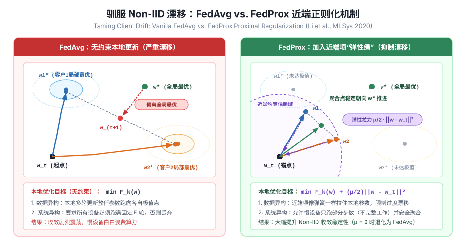
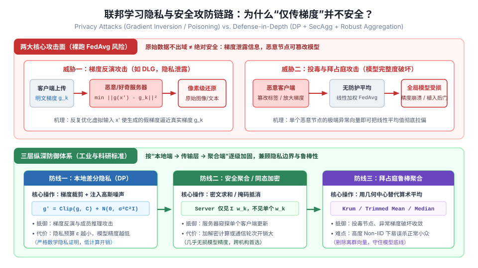

# 联邦学习第四课时：四大核心挑战与主流解法

> **学习目标**
> 1. 吃透联邦学习从“理想基线（FedAvg）”走向真实落地时面临的四大核心瓶颈：**统计异构**、**通信瓶颈**、**隐私与安全攻击**、**系统异构**。
> 2. 从第一性原理掌握 **FedProx**（近端正则化）、**SCAFFOLD**（控制变量方差缩减）如何抑制 Non-IID 客户端漂移。
> 3. 破除“不传原始数据 = 绝对安全”的误区，理解**梯度反演攻击**、**投毒攻击**的机理，以及**差分隐私**（DP）、**安全聚合**（SecAgg）和**鲁棒聚合**的纵深防御权衡。
> 4. 建立完整的“痛点—机理—代表算法—代价”知识矩阵，可直接用于文献综述梳理与学术汇报。

---

## 1. 挑战一：统计异构（Non-IID 数据）

真实世界的客户端数据由不同机构或用户自然产生，天然违背独立同分布假设（Non-IID），具体表现为：
* **标签分布偏斜**（Label Distribution Skew）：医院 A 病例以老年人慢病为主，医院 B 以儿科病例为主。
* **特征分布偏斜**（Feature Distribution Skew）：不同医院 CT 设备的成像分辨率与光照风格不同。
* **样本量极度不均衡**（Quantity Skew）：三甲医院样本量是社区诊所的数百倍。

第三课时已经看到，Non-IID 会导致严重的**客户端漂移**（Client Drift）。学术界主要通过以下三条路线攻克这一难题：

### 1.1 正则化约束：FedProx（Li et al., MLSys 2020）

**核心思想**：既然客户端在本地跑太远会偏离全局模型，就在本地损失函数后面系一根“弹性绳”——加入一个 **L2 近端正则项**（Proximal Term）：

$$\min_{w} h_k(w; w_t) = F_k(w) + \frac{\mu}{2} \Vert{} w - w_t \Vert{}^2$$

* **物理直觉**： $`w_t`$ 是本轮下发的全局模型“锚点”，超参数 $`\mu \ge 0`$ 控制“弹簧刚度”。当本地模型 $`w`$ 试图向局部极值 $`w_k^*`$ 过度漂移时，惩罚项 $`\frac{\mu}{2}\Vert{}w - w_t\Vert{}^2`$ 会产生指向 $`w_t`$ 的拉力，把本地更新限制在全局模型的信赖域内。
* **特例回归**：当 $`\mu = 0`$ 时，FedProx 严格退化为 FedAvg。
* **额外红利**：由于有近端项兜底，FedProx 在理论上允许算力弱的设备只做**部分本地更新**（ $`\gamma`$ -inexact 解）就提前上传，一箭双雕地缓解了系统异构问题。

### 1.2 梯度修正：SCAFFOLD（Karimireddy et al., ICML 2020）

**核心思想**：FedProx 是“拉住不让走太远”，代价是步子迈得慢；**SCAFFOLD** 则更进一步，通过引入**控制变量**（Control Variates）直接修正漂移方向。

服务器维护全局梯度估计 $`c`$ ，每个客户端维护本地梯度估计 $`c_k`$ 。在客户端本地更新时，每一步梯度都加上修正项 $`(c - c_k)`$ ：

$$w \leftarrow w - \eta \left( \nabla \ell(w; b) - c_k + c \right)$$

* **物理直觉**： $`\nabla \ell(w; b) - c_k`$ 抵消了客户端 $`k`$ 自身的分布偏置，再加上全局方向 $`c`$ ，从而让本地每一步更新都近似沿着真实的全局负梯度方向前进。代价是每次通信需要同时传输模型参数和控制变量，**通信量翻倍**。

### 1.3 范式转换：个性化联邦学习（Personalized FL, PFL）

如果不同客户端的数据分布本质上完全冲突（例如北方方言与南方方言的语音输入），强行拟合“一套放之四海而皆准的全局模型”本身就是伪命题。**PFL** 放弃追求单一全局模型，改为为每个客户端定制专属模型，常见做法包括：
* **全局预训练 + 本地微调**（Fine-tuning）。
* **共享特征提取层 + 本地私有分类头**（如 FedPer、FedRep）。
* **聚类联邦学习**（Clustered FL）：把数据分布相似的客户端聚为一类，分别训练各自的群组模型。

---

## 2. 挑战二：通信瓶颈（Communication Bottleneck）

现代深度学习模型参数量动辄数千万甚至数十亿（单个模型可达数百 MB 至数 GB），而手机、IoT 等边缘设备的**上行带宽通常远低于下行带宽**。除了 FedAvg 的“增加本地轮数 $`E`$ 减少通信次数”外，主流压缩手段聚焦于**降低单次通信的数据量**：

1. **梯度/参数量化**（Quantization）：降低参数表示的数值精度，例如将 32 位浮点数（FP32）压缩为 8 位整数（INT8）、甚至极端情况下的 1-bit 符号位（SignSGD，只传梯度正负号），直接将通信量压缩 **4 倍至 32 倍**。
2. **梯度稀疏化**（Sparsification）：深度学习中大部分梯度分量接近于 0，对收敛贡献极小。客户端仅上传绝对值最大的 **Top-k**（如前 1%~10%）梯度元素及其位置索引，其余置零；未被上传的小梯度通常缓存在本地做**误差反馈**（Error Feedback），累加到下一轮再传，避免信息丢失。
3. **低秩分解与结构化更新**：把大型权重矩阵更新 $`\Delta W \in \mathbb{R}^{m \times n}`$ 分解为两个极小的低秩矩阵乘积 $`A \cdot B`$ 进行传输（类似 LoRA 思路）。
4. **联邦知识蒸馏**（Federated Knowledge Distillation）：彻底抛弃传参数，改为在一个公共无标签数据集上，让各客户端只上传体积极小的**模型预测软标签**（Logits）进行聚合蒸馏，顺便还支持各客户端使用**异构模型结构**。

---

## 3. 挑战三：隐私与安全攻击（Privacy & Security）

> [!CAUTION]
> **必须打破的反常识认知：“不上传原始数据” $`\neq`$ “绝对安全”**
> 梯度本身就是原始输入样本的数学函数，上传明文梯度依然可能泄露像素级的原始隐私；同时，开放的分布式架构也让恶意节点有机可乘。

### 3.1 两大核心攻击面

1. **隐私窃取攻击**（通常假设服务器“诚实但好奇”，Honest-but-Curious）：
   * **梯度反演攻击**（Gradient Inversion，代表作 *Deep Leakage from Gradients / DLG*, NeurIPS 2019）：攻击者截获客户端上传的明文梯度 $`g_k`$ 后，在本地随机生成一张虚拟输入图像 $`x'`$ 和虚拟标签 $`y'`$ ，计算假梯度 $`g'`$ ，然后以 $`\min_{x', y'} \Vert{} g' - g_k \Vert{}^2`$ 为目标反复反向优化 $`x'`$ 。当假梯度逼近真实梯度时，虚拟图像 $`x'`$ 会惊人地收敛还原为客户端的真实隐私图像（Batch Size 较小时几乎像素级清晰）。
   * **成员推理攻击**（Membership Inference）：通过观察模型对某条数据的置信度或梯度响应，判断某个特定病人/用户是否参与过训练。
2. **模型完整性攻击**（假设存在恶意客户端）：
   * **无目标投毒 / 拜占庭攻击**（Byzantine Attack）：恶意客户端故意上传随机噪声、符号取反或放大数百倍的异常梯度。由于 FedAvg 是**线性加权平均**，**哪怕只有 1 个恶意节点**，只要把梯度放大足够大，就能直接摧毁整个全局模型的收敛性。
   * **后门攻击**（Backdoor Attack）：恶意节点让模型在正常测试集上表现完全正常（极难察觉），但只要输入中出现特定触发器（例如路标图片角落贴一个小方块），模型就会定向输出攻击者指定的错误结果。

### 3.2 三层纵深防御体系

| 防御层级 | 代表技术 | 核心机理 | 优点 | 核心代价 / 局限 |
| :--- | :--- | :--- | :--- | :--- |
| **本地端** | **差分隐私**（DP） | 先做**梯度裁剪**限制单样本最大影响（敏感度），再注入可控高斯噪声 | 提供严格的 $`(\epsilon, \delta)`$ 数学隐私保证；计算开销极低 | **隐私-效用权衡**：隐私保护越强（ $`\epsilon`$ 越小），注入噪声越大，模型精度掉得越惨 |
| **传输层** | **安全聚合**（SecAgg）与**同态加密**（HE） | 通过两两随机掩码抵消（SMPC）或密文直接相加（Paillier HE），使服务器只能看到聚合总和 $`\sum w_k`$ ，看不到任何单个 $`w_k`$ | **几乎无损模型精度**，彻底堵死单节点梯度反演 | 同态加密计算极慢、密文膨胀；SecAgg 通信轮次复杂且需处理掉线恢复 |
| **聚合端** | **拜占庭鲁棒聚合**（Krum / 中位数 / 截断均值） | 放弃脆弱的算术平均，改用对离群值不敏感的几何统计量（如剔除最大最小极值后求均值，或选距离邻居最近的梯度） | 有效抵御一定比例的恶意投毒节点 | 在高度 **Non-IID** 场景下极易“误伤”持有稀缺但正常数据的小众客户端 |

> [!TIP]
> **差分隐私（DP）的直观理解**：为什么 DP 在加噪前必须先做梯度裁剪 $`\text{Clip}(g, C)`$ ？
> 因为如果不限制单个梯度向量的最大范数（L2 Norm），某个极端样本产生的超大梯度信号就会冲破噪声掩护暴露自己。先用阈值 $`C`$ 截断梯度幅度，再叠加与 $`C`$ 成正比的高斯噪声 $`\mathcal{N}(0, \sigma^2 C^2 I)`$ ，就能从数学上保证“删掉或替换任意一条训练样本，输出分布几乎不可区分”。

---

## 4. 挑战四：系统异构（System Heterogeneity & Stragglers）

在跨设备联邦场景中，参与训练的硬件横跨旗舰手机、老旧安卓机与低功耗边缘芯片，算力、内存、电量和网络稳定性相差数十倍。

* **物理痛点——掉队者效应**（Straggler Effect）：经典 FedAvg 是**严格同步**（Synchronous）的，服务器必须等到本轮抽中的所有 $`m`$ 个客户端全部上传完参数才能聚合。一台卡顿的旧手机就会让全网几百台高速设备一起空等；如果直接设定超时并丢弃慢设备，又会导致系统只学到“高端手机用户”的偏好，引入严重的**设备选择偏差**（Selection Bias）。
* **主流解法**：
  1. **允许部分工作量**（如 FedProx）：在统一的时间截止点（Deadline）到来时，算力强的设备跑完了 5 个 Epoch，算力弱的设备只跑了 1 个 Epoch——服务器不再粗暴丢弃慢设备，而是直接接收并安全聚合其阶段性更新。
  2. **异步联邦学习**（Asynchronous FL，如 FedAsync）：服务器不再等待全员到齐，只要有客户端算完上传，就立刻按**陈旧度衰减权重**（Staleness Weighting）融合进全局模型：
     $$w_{\text{new}} = (1 - \alpha_t) w_{\text{current}} + \alpha_t w_{\text{client}}$$
     其中客户端使用的基础模型版本越旧（陈旧度越大），融合权重 $`\alpha_t`$ 越小，避免过期梯度把最新全局模型拉倒退。
  3. **智能客户端选择**（Client Selection，如 Oort）：摒弃纯粹随机抽样，综合评估客户端的**统计效用**（数据贡献大、损失高）与**系统速度**（算得快、网速好），优先挑选“又快又有价值”的设备参与当前轮次。

---

## 5. 全景总结
